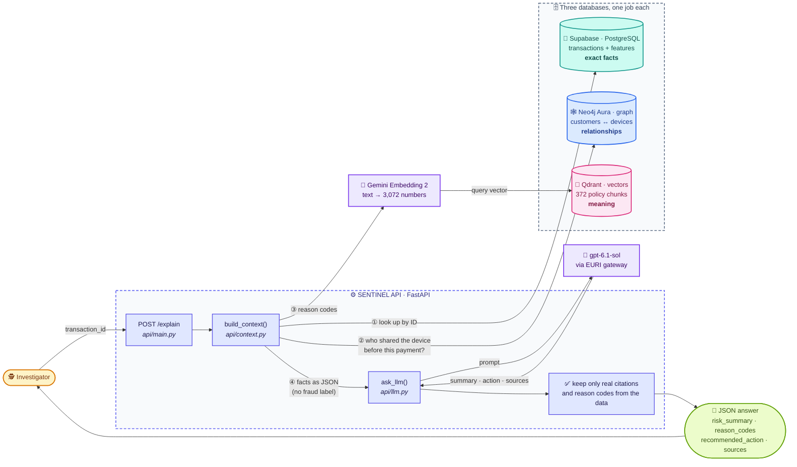

# SENTINEL investigator assistant

An API that explains why a payment looks risky. An investigator sends a `transaction_id` to
`POST /explain`. The service collects the facts about that payment from **three databases**, gives
them to an LLM, and returns a short risk summary, the reason codes that fired, a recommended action
and the policy documents the answer is based on.

## Architecture



**Read it in four steps:**
1. **Supabase**: read the payment and its features (amount, flags, the `reason_codes` that fired).
2. **Neo4j**: find other customers who used the same device **before** this payment, and whether any of them had fraud **before** it. Nothing from the future is used.
3. **Qdrant**: turn the reason codes into a question, embed it, and fetch the 5 closest policy chunks.
4. **LLM**: send all the facts as JSON and get back a summary, an action (`approve`, `review` or `block`) and the chunks it used. The API then drops any citation that was not really sent, and takes `reason_codes` from the data, not from the LLM.

## Which database stores what, and why

| Database | What it stores | Why this database |
|---|---|---|
| **Supabase** (PostgreSQL) | All 110,000 transactions and their features, including `reason_codes`. Fraud labels are in a separate `labels` table and are **never** sent to the LLM. | Tidy rows with a fixed shape, looked up exactly by `transaction_id`. It is the single source of truth that fills every other database. |
| **Neo4j Aura** (graph) | Customers, devices and payments as nodes and relationships (`USED_DEVICE`, `PAID`). A sample of 155 customers who share 20 devices, with 8,058 payments. | "Who else used this device, and did any of them commit fraud earlier?" is a relationship question. In a graph it is one short query; in SQL it needs several self-joins. |
| **Qdrant** (vector) | 372 chunks from 245 policy documents (playbooks, guidelines, regulatory exercises, case notes), each with a 3,072-number embedding from Gemini Embedding 2. | Investigators need guidance that **means** the same as the flags, even when the words differ. Vector search finds text by meaning, not by keywords. |
| MongoDB Atlas | A 150-customer sample from an earlier step. | Not used by `/explain`. |

## Files

| File | What it does |
|---|---|
| [main.py](main.py) | The FastAPI app: `GET /health`, `POST /context` (raw facts, for testing) and `POST /explain` |
| [context.py](context.py) | Collects the facts from Supabase, Neo4j and Qdrant |
| [llm.py](llm.py) | The rules for the LLM and the call to the EURI chat endpoint |
| [run_examples.py](run_examples.py) | Runs `/explain` on 5 fraud and 5 genuine validation payments |
| [hit_at_5.py](hit_at_5.py) | Measures retrieval hit@5 on 10 questions with a known answer document |
| [results/](results/) | Saved outputs of the two scripts above |

## How to run

From the project root, with `.env` filled in (Supabase, Neo4j, Qdrant and EURI keys):

```bash
python -m uvicorn api.main:app --reload     # start the API, then open http://127.0.0.1:8000/docs
python -m api.run_examples                  # in a second terminal, while the API is running
python -m api.hit_at_5                      # does not need the API
```

Free tiers of Supabase and Neo4j Aura pause after a few days without use. If you see a DNS error
such as `getaddrinfo failed`, resume the project in its dashboard and try again.

## Results

- **`/explain` on 10 validation payments** (5 fraud, 5 genuine), model `gpt-6.1-sol`:
  all 5 fraud were sent to `review`. Of the 5 genuine, 1 was approved (it had no flags) and 4 were sent to `review`.
  No payment was blocked. Responses: [results/explain_10.json](results/explain_10.json).
- **Retrieval hit@5 on 10 hand-written questions**: **9/10** (unique 5/5, topic 4/5).
  Results: [results/hit_at_5_results.json](results/hit_at_5_results.json).

## Known limitations

- **The graph is a sample.** Only 155 customers are in Neo4j, so for 9 of the 10 test payments the device was not in the graph.
- **No risk score in the context.** The LLM sees which flags fired but not how strong they are, so it sends almost every flagged payment to review.
- **Case stories compete with policy.** The one hit@5 miss (payment retries) returned case notes that describe the situation instead of the policy for it.
- **One "hub" chunk** (`DOC_regulatory_exercises_0000389`) appears in 7 of the 10 top-5 lists, which leaves less room for real answers.
- **Some corpus chunks hold findings from after the payment.** Fine for an investigator reviewing a case afterwards, but these must not be used for a real-time approve/block decision.
- **Small evaluation.** 10 payments and 10 questions are enough to spot problems, not to prove accuracy.
