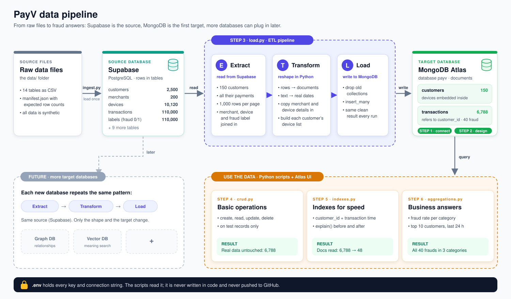

# PayV data pipeline: architecture

Files in this folder:
- `data_pipeline.svg`: the diagram (sharp at any size, shows on GitHub)
- `data_pipeline.png`: the same diagram as an image, for slides or documents

---

## The idea in one sentence

Data starts as files, is stored in **Supabase** (a SQL database), and a Python script moves part of it
into **MongoDB** in a new shape so that we can answer fraud questions quickly. Other databases can be
added later the same way.

## Read the diagram left to right, then down

### 1. Raw data files (grey)
The `data/` folder holds 14 tables as CSV files, plus `manifest.json`, which lists how many rows each
table should have. All the data is synthetic (generated, not from real people).

### 2. Supabase, the source database (teal)
`ingest.py` loads those files into Supabase **once**. Supabase is a PostgreSQL database, so the data is
stored in **tables with rows**, like spreadsheets: customers, merchants, devices, transactions, fraud
labels and 9 more tables. This is our **single source of truth**: every other database is filled from here.

### 3. `load.py`, the ETL pipeline (indigo, Step 3)
This is the heart of the diagram. ETL stands for three jobs done one after another:

| Job | What it means | What `load.py` does |
|---|---|---|
| **E: Extract** | read data from the source | reads 150 customers and all their payments from Supabase, 1,000 rows at a time, with merchant, device and fraud label joined in |
| **T: Transform** | change it into the shape we need | turns each flat row into a document, converts text dates into real dates, copies merchant and device details inside, builds each customer's device list |
| **L: Load** | write it to the target | drops the old collections and writes everything with `insert_many`, so every run gives the same clean result |

A simple way to picture it: **E** is collecting the ingredients, **T** is cooking them, **L** is putting the
dish on the table.

### 4. MongoDB Atlas, the target database (green, Steps 1 and 2)
The result lands in the `payv` database in **documents** instead of rows:
- `customers` (150): each customer has their **devices embedded inside**, because the list is small.
- `transactions` (6,788, of which 40 are fraud): their own collection, because payments keep growing.
  Each one **refers** to its customer by `customer_id`.

Step 1 is the secure connection to Atlas. Step 2 is the decision about this shape.

### 5. Use the data (orange, Steps 4 to 6)
Once the data is in MongoDB, we use it from Python scripts and the Atlas UI:

| Step | Script | What it shows | Result |
|---|---|---|---|
| 4 | `crud.py` | create, read, update, delete, done on test records | real data untouched: 6,788 |
| 5 | `indexes.py` | indexes on `customer_id` and transaction time, checked with `explain()` | documents read: 6,788 → 48 |
| 6 | `aggregations.py` | fraud rate per category; top 10 customers in their last 24 hours | all 40 frauds in electronics, gift cards and gaming |

### 6. Future: more target databases (grey, dashed)
The dashed box is where the next databases plug in, for example a **graph database** (good for
relationships: who shares a device with whom) or a **vector database** (good for searching text by
meaning). Each one follows the **same pattern**: extract from Supabase, transform the data into the shape
that database needs, load it. Only the shape and the target change. The source stays the same.

### 7. Security (dark strip at the bottom)
Every key and connection string lives in `.env`. The scripts read it, but it is never written in the code
and never pushed to GitHub.

---

## How to explain it in 30 seconds

> "Our data starts as files and is stored in Supabase, a SQL database, which is our single source of truth.
> A Python pipeline, `load.py`, does ETL: it **extracts** 150 customers and their payments, **transforms**
> the rows into MongoDB documents, and **loads** them into MongoDB Atlas. Then we use that data: basic
> operations, indexes that cut the work from 6,788 documents to 48, and aggregations that show all 40
> frauds are in just three categories. Other databases can be added later with the same
> extract-transform-load pattern."

## Why this design

- **One source, many targets.** Every database is filled from Supabase, so they never disagree about the data.
- **Each database gets the shape it is best at.** SQL keeps tidy tables; MongoDB gets ready-to-use documents.
- **Repeatable.** The pipeline drops and reloads, so running it again always gives the same result.
- **Easy to grow.** A new database means one new ETL script, not a redesign.
