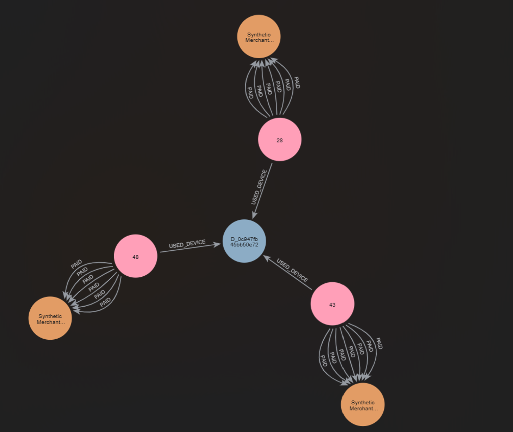
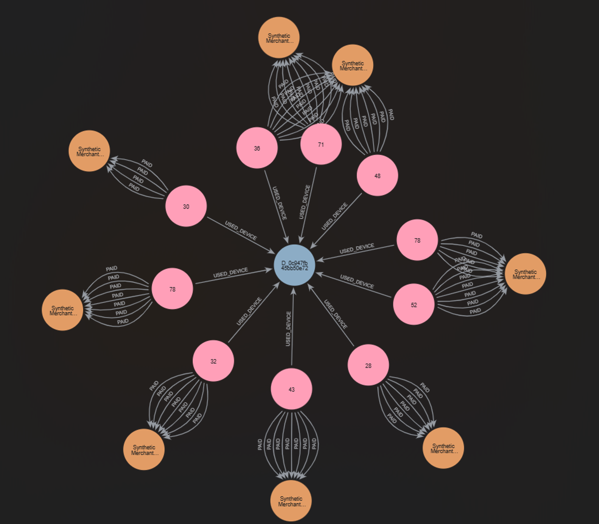

# PayV on Neo4j Aura

Part of the PayV fraud data (synthetic Indian payments, already loaded into Supabase with
`python ingest.py all`) modelled as a **graph** in Neo4j Aura and queried from Python with the
official **neo4j** driver.

Fraud often shows up in **relationships**, not in single rows: one device used by many customers,
or money from those devices flowing to the same merchants. A graph stores those connections
directly, so these patterns are easy to query and to see.

```
graph/
├── README.md       <- you are here
├── db.py           <- shared connection helper used by every script
├── connect.py      <- Step 1: connection test
├── load.py         <- Steps 2-3: copy a sample from Supabase into the graph (MERGE + constraints)
├── constraints_check.py  <- Step 3: prove that MERGE and the constraints stop duplicates
├── queries.py      <- Step 4: three fraud-hunting Cypher queries
├── cluster.png     <- Step 5: one suspicious cluster (7-day window)
└── cluster_full.png  <- Step 5: the same device over its whole life
```

| Step | What | Status |
|---|---|---|
| 1 | Neo4j Aura instance, connect with the neo4j driver and `verify_connectivity()` | Done |
| 2 | `Customer`, `Device`, `Merchant` nodes; `USED_DEVICE` and `PAID` relationships from at least 5,000 transactions | Done |
| 3 | `MERGE` instead of `CREATE`, uniqueness constraints on the ids | Done |
| 4 | Cypher: shared devices in 7 days, customers within 2 hops of fraud, merchants paid from shared devices | Done |
| 5 | Graph screenshot of one suspicious cluster, with an explanation | Done |

---

## Step 1 - Aura setup and connection

### Why Aura
Neo4j can run locally in Docker or in **Neo4j Aura**, Neo4j's managed cloud service (the Neo4j
equivalent of MongoDB Atlas). Aura was chosen because nothing has to be installed and the
**AuraDB Free** tier is large enough for this sample (it allows about 200,000 nodes and 400,000
relationships). A free instance pauses after a few days without use and can be resumed from the
Aura console.

### Aura
1. Signed in at <https://console.neo4j.io> and created an **AuraDB Free** instance.
2. Downloaded the credentials file when it was shown (the password is shown only once) and kept it
   **outside** the project folder.
3. Waited until the instance status was **Running**.

### Python
The credentials are kept in the project's `.env` (in `.gitignore`), never in code:
```
NEO4J_URI=neo4j+s://<instance-id>.databases.neo4j.io
NEO4J_USERNAME=<username from the credentials file>
NEO4J_PASSWORD=<password from the credentials file>
```
As an extra safety net, `.gitignore` also contains `Neo4j-*.txt`, the name pattern of Aura's
credentials file.

`requirements.txt` now includes `neo4j` (the driver) and `certifi` (see the certificate note below).

```bash
python -m pip install -r requirements.txt
python graph/connect.py
```
Expected output:
```
Connected to Neo4j at 34.124.169.171:7687
Server version: Neo4j/5.27-aura
Test query says: hello graph
```
- `verify_connectivity()` actually reaches the server and checks the username and password, like
  MongoDB's `ping`.
- `RETURN 'hello graph' AS msg` is a first Cypher query, to prove queries run.
- Port **7687** is Bolt, Neo4j's protocol for drivers.

### Problems met and how they were fixed

**1. `pip: Permission denied`.** `pip.exe` in the venv is a small unsigned launcher program, and
Windows 11 security can block it. Running pip through Python avoids the launcher and does exactly
the same thing:
```bash
python -m pip install neo4j
```

**2. `CERTIFICATE_VERIFY_FAILED: self-signed certificate in certificate chain`.**
Aura's certificate is signed by **SSL.com**, a genuine public certificate authority. On Windows,
Python checks certificates against the Windows list of trusted signers, and that list did not yet
contain SSL.com's root certificate (Windows adds some roots only when a browser first needs them).
Checking the same connection against **certifi**, Python's own up-to-date list, succeeded.

The fix lives in [db.py](db.py), so every script gets it:
```python
uri = os.environ["NEO4J_URI"].replace("neo4j+s://", "neo4j://")
driver = GraphDatabase.driver(
    uri,
    auth=auth,
    encrypted=True,
    trusted_certificates=TrustCustomCAs(certifi.where()),
)
```
`neo4j+s://` does not allow custom certificate settings, so the script uses `neo4j://` and turns
encryption on itself. The connection is still **encrypted and the certificate is still verified**;
only the list of trusted signers is different.

---

## Step 2 - Building the graph from Supabase

### The model
```
(:Customer)-[:USED_DEVICE {first_seen, last_seen, transactions}]->(:Device)
(:Customer)-[:PAID {transaction_id, amount, time, fraud_label, device_id}]->(:Merchant)
```

| Node | Properties | Key |
|---|---|---|
| `Customer` | customer_id, customer_age, home_city, region | customer_id |
| `Device` | device_id, device_kind (mobile / browser) | device_id |
| `Merchant` | merchant_id, name, category | merchant_id |

| Relationship | One per... | Properties |
|---|---|---|
| `USED_DEVICE` | customer + device pair | first_seen, last_seen (date-times), transactions (how many payments on that device) |
| `PAID` | transaction | transaction_id, amount (rupees), time (date-time), fraud_label (0/1), device_id |

Design choices:
- **One `PAID` arrow per transaction**, identified by `transaction_id`. Two payments to the same shop
  stay two arrows, each with its own amount, time and fraud label.
- **One `USED_DEVICE` arrow per customer-device pair**, not per payment. The question it answers is
  "who has used this device, and when", so first and last use plus a count are enough.
- **`device_id` is also stored on `PAID`.** The task puts `PAID` between Customer and Merchant, so on
  its own it does not say which device a payment came from. Query 3 in Step 4 ("merchants paid from
  shared devices") needs exactly that, so the device id travels with the payment. Payments made
  without a device simply have no `device_id` (Neo4j does not store null properties).
- **Times are stored as real Neo4j `datetime` values** (converted with `datetime()` in Cypher), not
  as text, so Step 4 can compare them ("within 7 days").
- Merchant locations are not copied: they are JSON objects, Neo4j properties cannot hold nested
  objects, and no query needs them.

### Choosing the sample
For MongoDB the sample was the first 150 customers. That would not work here: fraud rings span
**several customers who share a device**, and a random set of customers contains few of them. So the
sample is built **around shared devices**:

1. Read `transaction_id, customer_id, device_id` of all 110,000 transactions (3 small columns only).
2. For each device, collect the set of customers who used it.
3. Keep devices used by **3 or more customers** (120 in the full data), sorted by id so the choice is
   the same on every run, and take the first **20**.
4. Take every customer who used one of those 20 devices, and **all** of their transactions.

Measured before choosing the number 20:

| Shared devices taken | Customers | Their transactions |
|---:|---:|---:|
| 10 | 82 | 4,276 (below 5,000) |
| **20** | **155** | **8,058** |
| 30 | 237 | 12,330 |

### How `load.py` works
| Part | What it does |
|---|---|
| `fetch_transactions()` | reads transactions 1,000 at a time (the Supabase API limit), paging by `transaction_id > last_id`, optionally only for a list of customers |
| 1. Pick the sample | shared devices -> their customers, as above |
| 2. Fetch | all transactions of those customers, with `merchants(*)`, `devices(*)` and `labels(fraud_label)` joined in, plus their rows from `customers` |
| 3. Reshape | builds one Python list per node type and relationship type; dictionaries keyed by id remove duplicates. Transactions are sorted by time first, so the first use of a customer-device pair is `first_seen` and the last one is `last_seen` |
| 4. Constraints | one uniqueness constraint per id, created **before** any `MERGE` (details in Step 3) |
| 5. MERGE queries | `UNWIND $rows AS r` + `MERGE` + `SET`, one query per node or relationship type |
| `write()` | sends the rows in batches of 1,000 instead of one query per row |
| 6. Counts | counts nodes per label and relationships per type |

Order matters: nodes are written first, then relationships, because `MATCH` must find both ends
of an arrow before `MERGE` can draw it.

One of the MERGE queries:
```cypher
UNWIND $rows AS r
MATCH (c:Customer {customer_id: r.customer_id})
MATCH (m:Merchant {merchant_id: r.merchant_id})
MERGE (c)-[p:PAID {transaction_id: r.transaction_id}]->(m)
SET p.amount = r.amount, p.time = datetime(r.time),
    p.fraud_label = r.fraud_label, p.device_id = r.device_id
```

### Run
```bash
python graph/load.py
```
Output:
```
1. Finding shared devices
Fetched 110000 transactions from Supabase.
Found 20 shared devices -> 155 customers
2. Fetching their transactions
Fetched 8058 transactions from Supabase.
3. Writing to Neo4j
Nodes:
 Customer: 155
 Device: 383
 Merchant: 200
Relationships
  PAID: 8,058
  USED_DEVICE: 538
```

### Checks in Neo4j
| Check | Result |
|---|---|
| `PAID` arrows with a `fraud_label` | 8,058 / 8,058 |
| Fraud payments (`fraud_label = 1`) | 89 (1.1%, against about 0.6% in the full data) |
| `PAID` arrows with a `device_id` | 7,967 (the other 91 were made without a device) |
| `PAID.time` stored as a date-time | 8,058 / 8,058 |
| Devices per customer | 2 to 6 (average 3.5) |
| Devices used by 3+ customers in the graph | 24 |
| Uniqueness constraints | 4 |

- **383 devices** = the 20 chosen shared devices plus the customers' other phones and browsers.
- **24 shared devices, not 20**: the chosen customers also share 4 other devices among themselves,
  so the graph finds rings that were not picked on purpose.
- **Fraud rate 1.1%** is about twice the overall rate: starting from shared devices pulls in the
  riskier customers, as intended.
- The most shared device in the graph, `D_184ed5721b197852` (mobile), is used by **14 customers**.

A real fraud-labelled payment from the graph:
```
(:Customer {customer_id: "C_f9b5b518b79a7647", home_city: "Patna"})
  -[:PAID {transaction_id: "TX_0000000826", amount: 10060.58,
           time: 2024-10-07T23:10:06.294Z, fraud_label: 1,
           device_id: "D_47ea73b97b159243"}]->
(:Merchant {merchant_id: "M_fb626fe084cf053e", name: "Synthetic Merchant 000166",
            category: "gift_cards"})
```
A gift-card purchase late at night: the kind of "cash-out" payment the fraud labels concentrate on.

To see the rings in the Aura console (**Query** tab):
```cypher
MATCH (c:Customer)-[:USED_DEVICE]->(d:Device)
WITH d, count(c) AS customers WHERE customers >= 3
MATCH (c:Customer)-[u:USED_DEVICE]->(d)
RETURN c, u, d LIMIT 30
```

### Problems met and how they were fixed
The first version of `load.py` had five mistakes, found by reading it before running it:

| Mistake | Effect | Fix |
|---|---|---|
| `( ... )[:20]` without `sorted` | crash: a generator cannot be sliced | `sorted( ... )[:20]` |
| `m["merchant_name"]` | crash: the column is `synthetic_name` | `m["synthetic_name"]` |
| row key `"label"` | **silent**: Cypher reads `r.fraud_label`, so no arrow would get a fraud label | key renamed to `fraud_label` |
| `UNWIND $row` | crash: Python sends the parameter as `rows` | `UNWIND $rows` |
| `write(driver, MERGE_PAID, ...)` missing | **silent**: the graph would have no payments | line added |

The two silent ones are why the checks above count the properties in Neo4j, not only the rows.

---

## Step 3 - MERGE instead of CREATE, and uniqueness constraints

### The idea
| | `CREATE` | `MERGE` |
|---|---|---|
| What it does | always makes a new node or arrow | finds it first, creates it only if missing |
| Running the load twice | every customer and payment twice (or an error, once constraints exist) | the same graph as after one run |

`MERGE` alone is not a full guarantee: any other query that uses `CREATE` could still add a copy.
So every id also has a **uniqueness constraint**, a rule kept by the database itself:

```cypher
CREATE CONSTRAINT customer_id IF NOT EXISTS FOR (c:Customer) REQUIRE c.customer_id IS UNIQUE
CREATE CONSTRAINT device_id   IF NOT EXISTS FOR (d:Device)   REQUIRE d.device_id   IS UNIQUE
CREATE CONSTRAINT merchant_id IF NOT EXISTS FOR (m:Merchant) REQUIRE m.merchant_id IS UNIQUE
CREATE CONSTRAINT paid_id     IF NOT EXISTS FOR ()-[p:PAID]-() REQUIRE p.transaction_id IS UNIQUE
```
- The last one protects **relationships**: no two `PAID` arrows may share a `transaction_id`, so
  one payment is always exactly one arrow.
- `IF NOT EXISTS` makes the statements safe to re-run.
- Each constraint also creates an **index** on its property, so `MERGE` finds an existing id
  directly instead of checking every node (the same idea as the MongoDB indexes in Step 5 there).
- `load.py` creates the constraints **before** any `MERGE`, so every `MERGE` can use them.

In short: `MERGE` stops the load from *trying* to make duplicates, and the constraints stop
*anyone* from making them, even by mistake with `CREATE`. `USED_DEVICE` has no id of its own; it is
kept unique by `MERGE (c)-[u:USED_DEVICE]->(d)`, which finds the existing arrow between the pair.

### The proof
[constraints_check.py](constraints_check.py) runs three tests on a customer and a payment that are
already in the graph (`C_f9b5b518b79a7647` and `TX_0000000826`). None of them changes the graph:
`MERGE` finds what exists, and the `CREATE` attempts are refused.

```bash
python graph/constraints_check.py
```
Output:
```
A. Constraints in the database
 customer_id: NODE_PROPERTY_UNIQUENESS on Customer.customer_id
 device_id: NODE_PROPERTY_UNIQUENESS on Device.device_id
 merchant_id: NODE_PROPERTY_UNIQUENESS on Merchant.merchant_id
 paid_id: RELATIONSHIP_PROPERTY_UNIQUENESS on PAID.transaction_id

B1. MERGE a customer that already exists
 nodes created: 0

B2. CREATE the same customer again
 refused: Node(136) already exists with label `Customer` and property `customer_id` = 'C_f9b5b518b79a7647'

B3. CREATE a payment with an existing transaction_id
 refused: Relationship(6953557824660046370) already exists with type `PAID` and property `transaction_id` = 'TX_0000000826'

Customer C_f9b5b518b79a7647 exists 1 time(s)
payment TX_0000000826 exists 1 time(s)
```
| Test | Result | What it proves |
|---|---|---|
| A. `SHOW CONSTRAINTS` | 4 uniqueness constraints (3 on nodes, 1 on `PAID`) | the rules exist in the database |
| B1. `MERGE` an existing customer | `nodes created: 0` (from the query summary's counters) | `MERGE` found the node and made no copy |
| B2. `CREATE` the same customer | refused with a `ConstraintError` | duplicate **nodes** are blocked, even with `CREATE` |
| B3. `CREATE` a `PAID` arrow with an existing `transaction_id` | refused with a `ConstraintError` | duplicate **arrows** are blocked too |
| Final check | both exist exactly once | the graph is unchanged |

`Node(136)` and `Relationship(6953...)` in the messages are Neo4j's internal ids for the existing
node and arrow, not our ids.

The script expects the two `CREATE` attempts to fail, so it catches the error
(`except ConstraintError`) and prints "refused" instead of crashing.

### Re-running the whole load
```bash
python graph/load.py
```
The second run gave exactly the same counts as the first:

| | First run | Second run |
|---|---:|---:|
| Customer | 155 | 155 |
| Device | 383 | 383 |
| Merchant | 200 | 200 |
| PAID | 8,058 | 8,058 |
| USED_DEVICE | 538 | 538 |

With `CREATE` the second run would have tried to double everything (310 customers, 16,116
payments) and been stopped by the constraints with an error. With `MERGE` it finds everything
already there and only refreshes the properties (`SET`), so the load is **safe to re-run**.

---

## Step 4 - Fraud-hunting queries in Cypher

All three queries are in [queries.py](queries.py) (with a comment on every line). Run them with:
```bash
python graph/queries.py
```

### Query 1 - Devices shared by 3+ customers within 7 days
A device used by many accounts **over years** can be innocent (a family tablet, a shop's phone).
Many accounts on one device **within a few days** is a much stronger sign of one person running
several accounts. The query uses a **sliding window**:

1. Every payment made on a device is a possible start of a 7-day window.
2. From that start, collect the **different** customers who paid on the same device in the next 7 days.
3. Keep windows with 3 or more customers, and show the earliest one per device.

```cypher
MATCH (d:Device)<-[:USED_DEVICE]-(:Customer)-[p:PAID]->()
WHERE p.device_id = d.device_id
WITH d, p.time AS start
MATCH (d)<-[:USED_DEVICE]-(c:Customer)-[p2:PAID]->()
WHERE p2.device_id = d.device_id
  AND p2.time >= start AND p2.time < start + duration({days: 7})
WITH d, start, collect(DISTINCT c.customer_id) AS customers
WHERE size(customers) >= 3
WITH d, start, customers ORDER BY start
WITH d, collect({start: start, customers: customers})[0] AS first
RETURN d.device_id AS device, d.device_kind AS kind,
       first.start AS window_start, first.customers AS customers
ORDER BY window_start
```
- `p.device_id = d.device_id` keeps only payments really made **on** that device. This is why
  `device_id` was stored on `PAID` in Step 2.
- `start + duration({days: 7})` is date arithmetic; it works because times are stored as real
  date-times.
- `collect(DISTINCT ...)` counts a customer once, however many times they paid.

Result:
```
D_0c947fb45bb50e72 (mobile): from 2024-10-25 23:05 UTC -> C_984cb84b0a294365, C_148927ad36a84923, C_1aa451e90647f952
D_184ed5721b197852 (mobile): from 2025-12-21 08:40 UTC -> C_0cda98d09067c493, C_921598d920086e0e, C_a5d397884ef7d444
```
Of the 24 devices used by 3+ customers in the graph, only **2** had 3 customers inside one week.
Looking at their payments shows the same behaviour from every customer: **a burst of small payments,
then one large payment, all within a few minutes**.

Device `D_0c947fb45bb50e72`:

| Customer | When (UTC) | What happened |
|---|---|---|
| C_1aa451e90647f952 | 25 Oct 2024, 23:05-23:12 | 5 small gaming payments, then Rs 1,38,850.61 |
| C_984cb84b0a294365 | 27 Oct 2024, 06:40-06:46 | 6 small gift-card payments, then Rs 32,579.45 |
| C_148927ad36a84923 | 29 Oct 2024, 19:43-19:48 | 5 small gaming payments, then Rs 16,137.14 (**fraud_label = 1**) |

Device `D_184ed5721b197852` shows the same pattern in December 2025 (large payments of
Rs 56,285.19, Rs 84,399.23 and Rs 31,751.72; only the last is labelled fraud).

On each device only **one** payment carries a fraud label, but the graph links the other two large
payments to the same device and the same behaviour.

### Query 2 - Customers within 2 hops of a fraud-labelled payment
```
(fraud payment) --hop 1--> (Device it was made on) <--hop 2-- (other Customer)
```
```cypher
MATCH (payer:Customer)-[p:PAID {fraud_label: 1}]->(:Merchant)
MATCH (d:Device {device_id: p.device_id})<-[:USED_DEVICE]-(other:Customer)
WHERE other <> payer
WITH other, count(DISTINCT p) AS linked_fraud
OPTIONAL MATCH (other)-[own:PAID {fraud_label: 1}]->()
WITH other, linked_fraud, count(own) AS own_fraud
RETURN other.customer_id AS customer, other.home_city AS city, linked_fraud, own_fraud
ORDER BY linked_fraud DESC, customer
```
- `other <> payer` (`<>` means "not equal") removes the payer, who would otherwise find themselves.
- `linked_fraud`: how many fraud payments **other customers** made on devices this customer also uses.
- `own_fraud`: how many fraud payments **this customer** made. `OPTIONAL MATCH` keeps customers with
  none, so they get `0`.
- **Why the hops go through devices, not merchants:** going *fraud payment -> Merchant -> other
  customers* reaches **all 155** customers, because everyone shops at the same popular merchants.
  A shared device is a real link; a shared shop is not.

Result (top 10 of 151):
```
151 customers reached, 80 have no fraud of their own
C_adc4f9364f194b36 (Jamshedpur): linked to 8 fraud payments, own fraud: 2
C_daaa7576512c46f3 (Lucknow): linked to 8 fraud payments, own fraud: 0
C_8403fb2e903349ff (Pune): linked to 7 fraud payments, own fraud: 2
C_e8e8b85981b19866 (Jamshedpur): linked to 7 fraud payments, own fraud: 2
C_1dd9cd9f2aa4c226 (Bengaluru): linked to 6 fraud payments, own fraud: 1
C_216c42b55d959f30 (Lucknow): linked to 6 fraud payments, own fraud: 0
C_001ba2fd8bb7865d (Kochi): linked to 5 fraud payments, own fraud: 1
C_177aa533c668eb8a (Kochi): linked to 5 fraud payments, own fraud: 1
C_1eee836953b656c1 (Kochi): linked to 5 fraud payments, own fraud: 1
C_3c909a3ac86ceceb (Kolkata): linked to 5 fraud payments, own fraud: 0
```
- 151 of 155 customers are reached. That is expected: the sample was **built around shared devices**.
- The useful part is the **ranking**, and the **80 customers with no fraud of their own**. A check
  that looks at one customer at a time sees them as clean; the graph shows that, for example,
  `C_daaa7576512c46f3` uses devices on which 8 fraud payments were made. That does not prove fraud
  (they could be a victim or share a family phone), but it makes them worth reviewing.

### Query 3 - Merchants most often paid from shared devices
```cypher
MATCH (d:Device)<-[:USED_DEVICE]-(:Customer)
WITH d, count(*) AS users WHERE users >= 3
WITH collect(d.device_id) AS shared
MATCH (:Customer)-[p:PAID]->(m:Merchant)
WHERE p.device_id IN shared
RETURN m.name AS merchant, m.category AS category, count(p) AS payments,
       sum(p.fraud_label) AS fraud, count(DISTINCT p.device_id) AS devices
ORDER BY payments DESC
LIMIT 10
```
1. Find the shared devices (3+ customers) and collect their ids into one list.
2. Keep payments whose `device_id` is in that list.
3. Count per merchant; `sum(p.fraud_label)` counts fraud because labels are 0 or 1.

Result:
```
Synthetic Merchant 000005 (gaming): 55 payments from 8 shared devices, 3 fraud
Synthetic Merchant 000166 (gift_cards): 53 payments from 6 shared devices, 5 fraud
Synthetic Merchant 000135 (gaming): 45 payments from 5 shared devices, 1 fraud
Synthetic Merchant 000124 (electronics): 38 payments from 4 shared devices, 2 fraud
Synthetic Merchant 000004 (electronics): 36 payments from 5 shared devices, 2 fraud
Synthetic Merchant 000094 (electronics): 34 payments from 5 shared devices, 4 fraud
Synthetic Merchant 000074 (electronics): 34 payments from 5 shared devices, 2 fraud
Synthetic Merchant 000046 (gift_cards): 33 payments from 5 shared devices, 1 fraud
Synthetic Merchant 000146 (gift_cards): 32 payments from 4 shared devices, 0 fraud
Synthetic Merchant 000154 (electronics): 32 payments from 5 shared devices, 1 fraud
```
- All ten are **gaming, gift cards or electronics**: the same three categories that had all the
  fraud in the MongoDB analysis (fraud rate per merchant category). These are the shops where money
  is easiest to turn into something resellable.
- Shared devices made **1,189 payments, 60 of them fraud (about 5%)**, against **1.1%** for the
  whole graph: payments from shared devices are about 4-5 times riskier.

### Summary
| Query | Finding |
|---|---|
| 1 | 2 phones each used by 3 accounts within days, every account doing "small payments, then one large one" |
| 2 | 80 customers with a clean record of their own who use devices where fraud happened |
| 3 | payments from shared devices are about 5x riskier and go to gaming, gift cards and electronics |

### Problems met
Two mistakes in the first version of `queries.py`, both about capital letters:

| Mistake | Effect | Fix |
|---|---|---|
| `WITH OTHER, ...` | crash: variable `OTHER` not defined (the variable is `other`) | `WITH other, ...` |
| `MATCH (:CUSTOMER)-...` | **silent**: no node has the label `CUSTOMER`, so Query 3 would return nothing | `MATCH (:Customer)-...` |

In Cypher, keywords and functions ignore case (`MATCH` = `match`, `COLLECT` = `collect`), but
**variables, labels, relationship types and property names do not** (`Customer` is not `CUSTOMER`).

---

## Step 5 - One suspicious cluster in the graph view

### The cluster: device `D_0c947fb45bb50e72`
This is the first device found by Query 1 (3 customers within 7 days). The screenshots were taken
in the Aura console (**Query** tool, graph view).

The query for the 7-day window:
```cypher
MATCH (d:Device {device_id: 'D_0c947fb45bb50e72'})<-[u:USED_DEVICE]-(c:Customer)-[p:PAID]->(m:Merchant)
WHERE p.device_id = d.device_id
  AND p.time >= datetime('2024-10-25T00:00:00Z') AND p.time < datetime('2024-11-01T00:00:00Z')
RETURN d, u, c, p, m
```
- `p.device_id = d.device_id` keeps only payments made **on this phone**.
- The two `p.time` lines limit it to the week found by Query 1.
- Returning nodes **and** relationships (`d, u, c, p, m`) makes Neo4j draw a graph instead of a table.



How to read it:
- **Blue** = the device (`D_0c947fb45bb50e72`, a mobile phone).
- **Pink** = customers, labelled with their **age** (48, 43, 28).
- **Orange** = merchants.
- Every `PAID` arrow is one payment; every `USED_DEVICE` arrow points from a customer to the phone.

What the picture shows (7 nodes, 22 relationships):

| Customer (age) | City | Session on this phone | Paid to | Payments | Total |
|---|---|---|---|---:|---:|
| C_1aa451e90647f952 (48) | Delhi | 25 Oct 2024, 23:05-23:12 | Merchant 000185 (gaming) | 6 | Rs 1,78,322 |
| C_984cb84b0a294365 (43) | Lucknow | 27 Oct 2024, 06:40-06:46 | Merchant 000026 (gift_cards) | 7 | Rs 52,193 |
| C_148927ad36a84923 (28) | Patna | 29 Oct 2024, 19:43-19:48 | Merchant 000165 (gaming) | 6 | Rs 31,691 (1 fraud) |

### The same phone over its whole life
Without the two date lines, the query shows every payment ever made on this phone:



| | Value |
|---|---:|
| Customers who used the phone | 10 (from 8 different cities) |
| Payments made on it | 64 |
| Merchants paid | 8 (gaming, gift cards and electronics only) |
| Total amount | about Rs 4,06,058 |
| Payments labelled fraud | 3 |

The picture is a **star**: one phone in the middle, ten customers around it, each linked to one or
two shops by a tight bundle of `PAID` arrows.

### Why this cluster is suspicious
1. **One phone, many people.** Three accounts from Delhi, Lucknow and Patna used the same phone
   within 4 days; ten accounts from eight cities used it over its life. A personal phone does not
   travel between people like that.
2. **Each account used it only once.** Every one of the ten customers used this phone for a single
   session of 2-10 minutes and never again. All three customers in the first picture also have
   3-4 devices of their own for their normal payments.
3. **The same behaviour every time.** Each of the three sessions in the first picture is a few
   small payments followed by one large one, within minutes. Small payments test that the account works; the large one is the cash-out.
4. **The same kind of shops.** Only gaming, gift cards and electronics, where money is easiest to
   resell. This matches Query 3 and the MongoDB fraud-rate-per-category result.
5. **Most of it is not labelled.** Only 3 of the 64 payments carry a fraud label (in the first
   picture, only the Rs 16,137 payment at the end of the third session). The graph shows the other
   sessions follow the same pattern on the same phone, so they should be reviewed too.

**Likely explanation: account takeover.** One person's phone logs into several victims' accounts,
one at a time, and empties each with a quick burst of payments at resellable shops. Looking at
transactions one by one, each session looks like a normal customer making a few purchases; drawn as
a graph, the shared phone in the middle makes the pattern visible at a glance.

### What a fraud team would do next
- Block or flag the device `D_0c947fb45bb50e72`, so any new login from it is challenged.
- Contact the ten customers: they are more likely victims than fraudsters.
- Review the unlabelled large payments in these sessions as probable fraud.
- Run the same check (Query 1) regularly, so new shared-phone bursts are caught within days.
