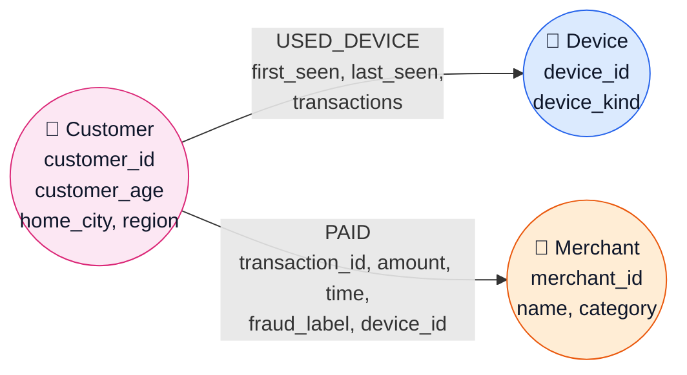

# PayV in Neo4j: the database design

This note explains how the PayV fraud data is designed as a **graph** in Neo4j, and why. You don't need to
know Neo4j beforehand.

---

## 1. The design in one picture



The same thing written in Cypher, Neo4j's query language:
```
(:Customer)-[:USED_DEVICE {first_seen, last_seen, transactions}]->(:Device)
(:Customer)-[:PAID {transaction_id, amount, time, fraud_label, device_id}]->(:Merchant)
```

**In one sentence:** customers **use** devices and **pay** merchants. Every payment is an arrow from a customer
to a merchant.

---

## 2. Graph words in plain English

| Graph word | Meaning | In PayV | SQL equivalent |
|---|---|---|---|
| **Node** | a thing | a customer, a device, a merchant | a row |
| **Label** | the type of a node | `Customer`, `Device`, `Merchant` | a table name |
| **Relationship** | a connection between two nodes, with a direction | `USED_DEVICE`, `PAID` | a foreign key or join table |
| **Property** | a value stored on a node or relationship | `home_city`, `amount` | a column |

**Key difference from SQL:** in SQL a connection is worked out at query time with a **JOIN**. In a graph the
connection is **stored** as a relationship, so following it is instant.

---

## 3. Why a graph for fraud?

Fraud often hides in **connections**, not in single records:
- one phone used by many different customers;
- money from those phones flowing to the same shops.

Looking at one payment at a time, each looks normal. In a graph you can **walk the connections**: from a fraud
payment, to the phone it came from, to every other customer who used that phone. That's two hops, and a single
short query does it.

---

## 4. The nodes (the things)

| Node | Properties | Unique key | Count |
|---|---|---|---:|
| 👤 `Customer` | `customer_id`, `customer_age`, `home_city`, `region` | `customer_id` | 155 |
| 📱 `Device` | `device_id`, `device_kind` (mobile / browser) | `device_id` | 383 |
| 🏪 `Merchant` | `merchant_id`, `name`, `category` | `merchant_id` | 200 |

Each node keeps only the few properties the queries actually use.

---

## 5. The relationships (the connections)

| Relationship | Direction | One arrow per... | Properties | Count |
|---|---|---|---|---:|
| `USED_DEVICE` | Customer → Device | customer + device **pair** | `first_seen`, `last_seen`, `transactions` (how many payments) | 538 |
| `PAID` | Customer → Merchant | **payment** | `transaction_id`, `amount` (rupees), `time`, `fraud_label` (0/1), `device_id` | 8,058 |

### A real example from the graph
```
(:Customer {customer_id: "C_f9b5b518b79a7647", home_city: "Patna"})
   -[:PAID {transaction_id: "TX_0000000826", amount: 10060.58,
            time: 2024-10-07T23:10:06Z, fraud_label: 1,
            device_id: "D_47ea73b97b159243"}]->
(:Merchant {name: "Synthetic Merchant 000166", category: "gift_cards"})
```
Read it as: "A customer from Patna **paid** Rs 10,060 to a gift-card shop late at night, from device
D_47ea…, and this payment is labelled fraud."

---

## 6. The design decisions, and why

### Decision 1: one `PAID` arrow per payment
Two payments to the same shop are **two arrows**, each with its own amount, time and fraud label. If they were
merged into one arrow, we would lose which payment was fraud and when it happened.

### Decision 2: one `USED_DEVICE` arrow per customer–device pair, not per payment
The question this arrow answers is "**who has used this device, and when?**" For that, the first use, the last
use and a count are enough. One arrow per payment would add thousands of arrows with no new information.

### Decision 3: `device_id` is also stored on `PAID`
`PAID` goes from Customer to Merchant, so on its own it doesn't say **which device** the payment was made on. A
customer can have several devices. The fraud queries need exactly that ("payments made **on** this shared
phone"), so the device ID travels with each payment. Payments made without a device simply don't have this
property.

### Decision 4: times are real date-times, not text
`time`, `first_seen` and `last_seen` are stored as Neo4j `datetime` values (converted with `datetime()` when
loading). That makes date maths possible, for example "payments within 7 days":
`p.time < start + duration({days: 7})`.

### Decision 5: amounts in rupees on `PAID`
`amount` is the transaction amount in rupees, so query results are directly readable.

### Decision 6: leave out what no query needs
Merchant locations are JSON objects, and Neo4j properties can't hold nested objects. No query needs them, so
they aren't copied. **Keep the graph small and focused on the questions.**

### Decision 7: Device is its own node, not a property of Customer
This is the most important choice. If the device were just a property of each customer, two customers sharing a
phone would just be two copies of the same text. As a **node**, a shared phone is **one point in the middle**
with arrows from every customer who used it. That's exactly the fraud ring we want to find, and you can see it
in the graph view.

---

## 7. Rules that keep the data clean (Step 3)

### Uniqueness constraints
Each ID can exist only once. The database itself enforces this:

```cypher
CREATE CONSTRAINT customer_id IF NOT EXISTS FOR (c:Customer) REQUIRE c.customer_id IS UNIQUE
CREATE CONSTRAINT device_id   IF NOT EXISTS FOR (d:Device)   REQUIRE d.device_id   IS UNIQUE
CREATE CONSTRAINT merchant_id IF NOT EXISTS FOR (m:Merchant) REQUIRE m.merchant_id IS UNIQUE
CREATE CONSTRAINT paid_id     IF NOT EXISTS FOR ()-[p:PAID]-() REQUIRE p.transaction_id IS UNIQUE
```
- Three rules on **nodes**, one on **relationships**: one payment is always exactly one `PAID` arrow.
- Each constraint also creates an **index**, so looking up an ID is fast.
- `USED_DEVICE` has no ID of its own. It stays unique because `MERGE` always reuses the existing arrow
  between a customer and a device.

### `MERGE` instead of `CREATE`

| | `CREATE` | `MERGE` |
|---|---|---|
| What it does | always makes a new node or arrow | finds it first, creates it only if missing |
| Loading twice | duplicates (or an error, with constraints) | the same graph as after one load |

**In short:** `MERGE` stops the load from *trying* to make duplicates, and the constraints stop *anyone* from
making them, even by mistake.

### Load order
1. Constraints first, so every `MERGE` can use their indexes.
2. Nodes next: Customer, Device, Merchant.
3. Relationships last: an arrow needs both of its ends to exist already.

---

## 8. What the design makes easy

| Question | How the design answers it |
|---|---|
| Which devices are shared by 3+ customers? | count `USED_DEVICE` arrows into each Device |
| Did 3+ customers use one device **within 7 days**? | `PAID.device_id` + `PAID.time` as a real date-time |
| Who is 2 hops from a fraud payment? | fraud `PAID` → its Device → other customers' `USED_DEVICE` |
| Which shops get paid from shared devices? | `PAID.device_id` in the list of shared devices |
| What does one fraud ring look like? | return the nodes and arrows; Neo4j draws a star around the shared phone |

Example: devices shared by 3 or more customers.
```cypher
MATCH (c:Customer)-[:USED_DEVICE]->(d:Device)
WITH d, count(c) AS customers
WHERE customers >= 3
RETURN d.device_id, customers
ORDER BY customers DESC
```

---

## 9. The same data in three databases

| | Supabase (SQL) | MongoDB | Neo4j |
|---|---|---|---|
| Stores data as | rows in tables | documents | nodes and relationships |
| A payment is | a row in `transactions` | a document with merchant and device copied inside | a `PAID` arrow from customer to merchant |
| A device is | a row in `devices` | an item in the customer's `devices` list | its own node, shared by everyone who used it |
| Connections | worked out with JOINs at query time | copied inside documents | stored as arrows |
| Best question | "give me tidy, exact records" | "what is in this payment?" | "who is connected to whom?" |

---

## 10. How to explain it in 30 seconds

> "In Neo4j we have three kinds of things: customers, devices and merchants. Customers **use** devices and
> **pay** merchants, and those connections are stored as arrows. Each payment is its own `PAID` arrow, with the
> amount, time, fraud label and the device it came from. A device is its own node, so when several customers
> share a phone, that phone sits in the middle with arrows from all of them. That's how fraud rings become
> visible. Uniqueness constraints and `MERGE` make sure nothing is ever duplicated, even if we load twice."

---

## 11. Questions people often ask

**Why not store the device on the customer, like in MongoDB?**
In MongoDB each customer's document has its own copy of the device. That's fine for "show me this customer". But
here we want "show me **everyone** on this device". As its own node, the device connects all its users directly.

**Why is `PAID` between Customer and Merchant, not Device and Merchant?**
A payment is made **by a customer to a merchant**. That's the business fact. The device is extra context, so it
goes in a property (`device_id`) on the payment.

**Why aren't all 2,500 customers loaded?**
The free Aura tier is limited, and fraud rings involve customers who share devices. So the sample was built
**around shared devices**: 20 shared phones, their 155 customers, and all 8,058 of their payments.

**Can the graph hold duplicates?**
No. The uniqueness constraints refuse a second customer, device, merchant or payment with the same ID. We
tested it: `CREATE` attempts were refused, and loading twice gave exactly the same counts.

**What's the direction of an arrow for?**
It shows who did what: a customer **used** a device, a customer **paid** a merchant. Queries can still follow
arrows in either direction.
