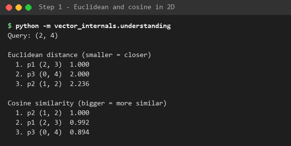
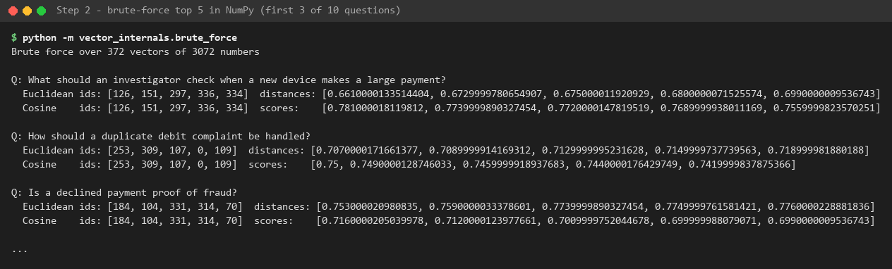
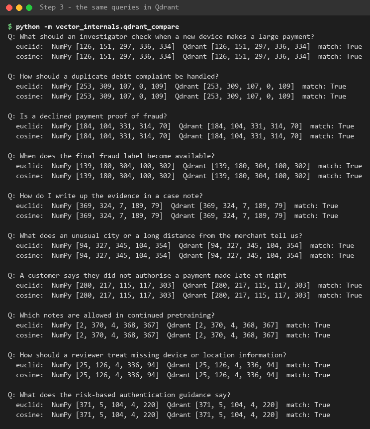
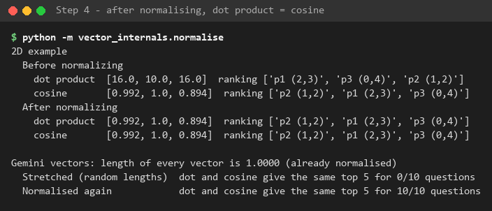
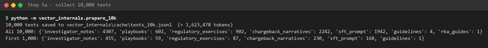
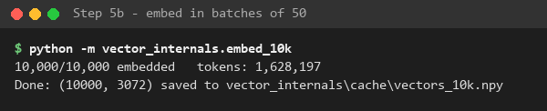
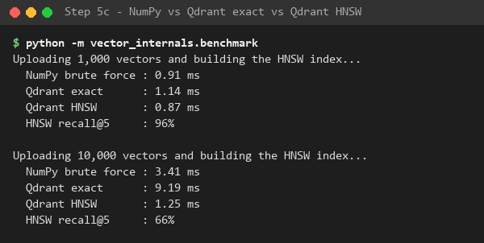

# Vector search internals: from 2D maths to HNSW

The [semantic search module](../vectors/README.md) uses Qdrant to find passages by meaning. This module looks at **what happens inside that search**:

- how Euclidean distance and cosine similarity rank results;
- a brute-force search written by hand in NumPy, checked against Qdrant;
- why normalised vectors make cosine and dot product interchangeable;
- how much an **HNSW index** speeds things up, and what it costs in accuracy.

It reuses the PayV corpus, the Gemini Embedding 2 vectors (3,072 numbers each) and the same 10 reference questions as the semantic search.

---

## How it works

```
Steps 1–4: the maths, on small data

  understanding.py   2D example by hand       → Euclidean and cosine rankings
  brute_force.py     NumPy over 372 vectors   → top 5 per question, both measures
  qdrant_compare.py  same queries in Qdrant   → identical results (20/20)
  normalise.py       stretch, then normalise  → cosine = dot product in ranking

Step 5: speed, on 10,000 real vectors

  data/corpus + training prompts ──► prepare_10k.py ──► embed_10k.py ──────────► benchmark.py
                                     10,000 unique       Gemini Embedding 2        NumPy vs Qdrant exact
                                     texts               batches of 50             vs Qdrant HNSW
                                                         (10,000 × 3,072)          at 1,000 and 10,000
```

### Files

| File | Role |
|---|---|
| [understanding.py](understanding.py) | Euclidean distance and cosine similarity on three 2D points, written with plain Python maths |
| [brute_force.py](brute_force.py) | Brute-force top-k in NumPy over the 372 chunk vectors. Also provides `load_chunks()` and `load_queries()`, which the other scripts reuse |
| [qdrant_compare.py](qdrant_compare.py) | Runs the same queries in Qdrant and checks the results against NumPy |
| [normalise.py](normalise.py) | Shows that after normalising, dot product ranks exactly like cosine |
| [prepare_10k.py](prepare_10k.py) | Collects 10,000 unique texts for the benchmark |
| [embed_10k.py](embed_10k.py) | Embeds them in batches (resumable), giving `cache/vectors_10k.npy` |
| [benchmark.py](benchmark.py) | Times NumPy, Qdrant exact and Qdrant HNSW, and measures HNSW recall |
| [screenshots/](screenshots/) | Terminal output of each step |

`cache/` is git-ignored. It holds `queries.json` (the 10 question vectors), `texts_10k.jsonl`, `batches/` and `vectors_10k.npy`, and all of these can be rebuilt.

---

## Setup

### Prerequisites

- The **semantic search module set up and run** ([vectors/README.md](../vectors/README.md)): Steps 1–4 read its vectors from `vectors/cache/embeddings.jsonl` and reuse its `embed()` function and questions.
- A **Qdrant Cloud** cluster (the free tier is enough) and a **EURI** API key. These are the same ones the semantic search uses.
- About **1.7M EURI tokens** for the 10,000 embeddings in Step 5. Steps 1–4 need only 10 small calls, for the questions, on the first run.

### Environment

From the project root, with the same virtual environment as the rest of the project:

```bash
source .venv/Scripts/activate        # Git Bash on Windows
python -m pip install -r requirements.txt
```

The packages used here (`numpy`, `pandas`, `requests`, `qdrant-client`, `langchain-text-splitters`, `python-dotenv`) are all pinned in `requirements.txt`.

`.env` in the project root needs the same three keys as the semantic search:

```
QDRANT_URL=https://<your-cluster>.cloud.qdrant.io
QDRANT_API_KEY=<qdrant key>
EURI_API_KEY=<euri key>
```

---

## How to run

Run every command **from the project root**, as a module, so the imports between folders work.

| Order | Command | What it does | API cost | Time |
|---|---|---|---|---|
| 1 | `python -m vector_internals.understanding` | 2D Euclidean and cosine rankings | none | instant |
| 2 | `python -m vector_internals.brute_force` | NumPy top 5 for the 10 questions | 10 small calls, first run only (cached in `queries.json`) | seconds |
| 3 | `python -m vector_internals.qdrant_compare` | Rebuilds the `payv_internals` test collection, then compares results | none | ~30 s |
| 4 | `python -m vector_internals.normalise` | Dot product vs cosine, before and after normalising | none | seconds |
| 5a | `python -m vector_internals.prepare_10k` | Writes `cache/texts_10k.jsonl` | none | ~1 min |
| 5b | `python -m vector_internals.embed_10k` | Embeds the 10,000 texts in 200 requests | ~1.63M tokens | 10–25 min |
| 5c | `python -m vector_internals.benchmark` | Uploads 1,000 then 10,000 vectors to `payv_benchmark` and times the searches | none | a few minutes |

**Resuming Step 5b.** Each finished batch is saved straight away as `cache/batches/batch_XXXXX.npy`, so an interrupted run continues where it stopped without paying twice. If you change `BATCH_SIZE` or the texts, **delete `cache/batches/` first**.

**Test collections.** `payv_internals` and `payv_benchmark` exist only for these experiments; nothing else reads them. Delete them when you're done:

```bash
python -c "from vectors.db import get_client; c = get_client(); [c.delete_collection(n) for n in ('payv_internals', 'payv_benchmark') if c.collection_exists(n)]"
```

---

## Screenshots

**1. The 2D example:** the two measures pick different winners.



**2. Brute force in NumPy:** Euclidean and cosine return the same ids for the Gemini vectors (first 3 of 10 questions).



**3. Qdrant returns exactly what NumPy returns**



**4. Normalising makes dot product rank like cosine**



**5. 10,000 texts for the benchmark**



**6. Embedding in batches**



**7. The benchmark**



---

## 1. Euclidean distance and cosine similarity in 2D

Three stored points and one query, small enough to check by hand:

```
p1 = (2, 3)    p2 = (1, 2)    p3 = (0, 4)        query = (2, 4)
```

| Measure | Formula | Ranking |
|---|---|---|
| Euclidean distance (smaller = closer) | √((x₁−x₂)² + (y₁−y₂)²) | **p1 1.000**, p3 2.000, p2 2.236 |
| Cosine similarity (bigger = more similar) | (A · B) / (‖A‖ × ‖B‖) | **p2 1.000**, p1 0.992, p3 0.894 |

The two measures disagree:
- **Euclidean** measures **position**: p1 is physically nearest.
- **Cosine** measures **direction**: p2 = (1, 2) points exactly the same way as (2, 4), just shorter, so its cosine is a perfect 1.0.

For text embeddings, direction carries the meaning, which is why cosine is the usual choice.

---

## 2. Brute force in NumPy

Brute force compares the question with **every** stored vector, then sorts. With the 372 vectors as one matrix, this is a single line each:

```python
distances = np.linalg.norm(vectors - query, axis=1)                                 # Euclidean, all rows at once
scores = (vectors @ query) / (np.linalg.norm(vectors, axis=1) * np.linalg.norm(query))  # cosine, all rows at once
best = np.argsort(-scores)[:5]                                                      # positions of the 5 best
```

**Result: for all 10 questions, Euclidean and cosine return the same 5 ids in the same order.** In 2D they disagreed, so why not here? The Gemini vectors are **normalised** (every vector has length 1), and for unit vectors:

```
distance² = 2 − 2 × cosine
```

So a higher cosine always means a smaller distance, and the two rankings must match. For example, question 1's best chunk has cosine 0.781 and distance √(2 − 2 × 0.781) = 0.661, which is exactly what the script prints.

The cosine scores also match the semantic search's results (0.781, 0.774, 0.772 … for question 1).

---

## 3. Qdrant gives the same answers

`qdrant_compare.py` uploads the same 372 vectors into a test collection with **two named vectors per point**:
- `"cosine"`, compared with `Distance.COSINE`;
- `"euclid"`, compared with `Distance.EUCLID`.

It then asks both (`query_points(..., using=name)`) and compares the results with NumPy to 4 decimals.

**Result: 20 of 20 comparisons match** (10 questions × 2 measures), with the same ids, same order and same scores. On a collection this small, Qdrant does what the NumPy code does: it checks every vector. Section 5 explains why.

---

## 4. Normalisation: cosine = dot product

Cosine is the dot product divided by the two lengths. If every length is 1, the division changes nothing:

```
cosine(A, B) = (A · B) / (‖A‖ × ‖B‖) = (A · B) / (1 × 1) = A · B
```

`normalise()` divides each vector by its own length:

```python
m / np.linalg.norm(m, axis=-1, keepdims=True)   # every row now has length 1, same direction
```

| Test | Before normalising | After normalising |
|---|---|---|
| 2D points | Dot product ranks p1, p3, p2 (p1 and p3 tie at 16); cosine ranks p2, p1, p3 | Both rank **p2, p1, p3** |
| Gemini vectors, each stretched to a random length (×0.5–2.0) | Dot and cosine give the same top 5 for **0/10** questions | **10/10** |

**Why stretch the Gemini vectors?** They're already normalised, so dot and cosine agree from the start, and that proves nothing. Stretching gives each vector a random length:
- the dot product then rewards **long** vectors, not similar ones (in question 1, a chunk stretched ×1.97 jumped to first place);
- normalising removes the length again, and the rankings agree.

**Why it matters:** with normalised vectors, a database can use the cheaper dot product and still get cosine rankings. Qdrant does this itself: a `COSINE` collection normalises vectors on upload.

---

## 5. Benchmark: brute force vs HNSW

### Data

To time searches at realistic sizes, `prepare_10k.py` collects **10,000 unique texts** from real project data:

| Source | Texts | How |
|---|---|---|
| Corpus, all document types and all splits | 8,058 | Same cleaning and chunking as the semantic search (800 characters, 150 overlap), duplicates removed |
| Training prompts (`data/training/sft/train`) | 1,942 | Topped up until there are 10,000, duplicates removed |

The list is shuffled with a fixed seed, so the **first 1,000** (the small test) are a mix of every kind.

`embed_10k.py` sends **50 texts per request**. The EURI endpoint accepts a list and returns one vector per text; a test showed batch and single-text vectors are identical (cosine 1.0). That's 200 requests instead of 10,000, which avoids rate limits. The run used **1,628,197 tokens**.

### Method

For each size (the first 1,000 vectors, then all 10,000), `benchmark.py`:

1. **Uploads** the vectors to `payv_benchmark` over gRPC, which sends numbers as compact binary rather than JSON text and makes large uploads faster.
2. **Forces an HNSW index** and waits until `indexed_vectors_count` equals the number of vectors (see [Qdrant's thresholds](#qdrants-thresholds)).
3. **Times three searches**, each averaged over the 10 questions:
   - **NumPy**: brute force on the laptop.
   - **Qdrant exact**: brute force on the server (`"params": {"exact": true}`).
   - **Qdrant HNSW**: the index (`"exact": false`).
4. **Measures recall@5**: how many of NumPy's true top 5 HNSW also returned, across 50 results (10 questions × 5).

**Qdrant's own timing.** Qdrant times are read from the `"time"` field of its REST reply. That's the server's search time, without the network. A round trip from the laptop to the cloud takes a few hundred milliseconds, so a stopwatch would mostly measure the internet connection.

### Results

| Vectors | NumPy brute force | Qdrant exact | Qdrant HNSW | HNSW recall@5 |
|---|---|---|---|---|
| 1,000 | 0.91 ms | 1.14 ms | 0.87 ms | 96% |
| 10,000 | 3.41 ms | 9.19 ms | **1.25 ms** | **66%** |
| **Growth (10× data)** | ×3.7 | **×8.1** | **×1.4** | |

These are single runs, on a laptop and on a shared free-tier cluster, so individual numbers will vary. The *growth* is the useful part.

### Reading the results

- **Qdrant exact grows ×8 for 10× the data.** That's brute force: twice the vectors means twice the work.
- **HNSW grows only ×1.4.** It visits a few hundred points whatever the collection size, so its search time barely moves. At 10,000 vectors it's already **7× faster** than exact search on the same server.
- **NumPy grows only ×3.7.** At 1,000 vectors the fixed cost of each call is a large share of the 0.91 ms, and the laptop's maths library multiplies matrices with several cores at once. At larger sizes NumPy would grow linearly too.
- **At 1,000 vectors there's almost no difference.** All three take about 1 ms. That's why Qdrant doesn't bother with HNSW for small collections by default.

### Why recall dropped to 66%

HNSW is **approximate**: it follows a graph instead of checking everything, and the graph can lead it to the wrong place. Investigating the 10,000 collection directly:

| Check | Result |
|---|---|
| Qdrant exact vs NumPy | 100% match, so the code and the data are fine |
| Vector lengths | All 1.0 |
| Indexed vectors | 10,000 of 10,000 |

The true ranks of the 5 results HNSW returned, per question:

```
Q1–Q4, Q7   [1, 2, 3, 4, 5]          perfect
Q9          [2, 3, 4, 5, 7]          near miss
Q10         [3, 4, 6, 7, 8]          near miss
Q8          [1, 2, 19, 20, 23]
Q5          [9, 11, 14, 16, 17]      wrong neighbourhood
Q6          [31, 32, 33, 34, 36]     wrong neighbourhood
```

Half the questions are perfect. The rest fail because **the data is very crowded**:
- About 4,300 of the 10,000 texts are investigator notes generated from templates.
- The top scores are packed together: one question's 3rd–7th scores are 0.7179, 0.7176, 0.7174, 0.7172, 0.7172.
- In such dense clusters, the graph's links can lead the search into a neighbouring cluster, and it stops there.

At 1,000 vectors the clusters are small, which is why recall was 96%.

Searching harder only helps a little. Re-running the HNSW query on the same index with a larger search beam (`hnsw_ef`, the number of candidates kept during the search):

| `hnsw_ef` | default | 64 | 128 | 256 | 512 |
|---|---|---|---|---|---|
| Recall@5 at 10,000 | 66% | 66% | 66% | 76% | 78% |

The limit is the **graph itself**, which was built with the default settings. See [Try it yourself](#try-it-yourself) for how to build a better one.

---

## What an HNSW index changes

### Without an index: a flat list

The vectors are stored one after another, and every search compares the question with all of them:

```
question ──► vector 0 ──► vector 1 ──► vector 2 ──► … ──► vector 9,999      10,000 comparisons, then sort
```

The work grows **in step with the data**: 10× the vectors means 10× the time.

### With HNSW: the same vectors, plus a map of neighbours

HNSW (Hierarchical Navigable Small World) adds a **graph**. Each vector keeps links to its closest neighbours (`m`, 16 by default). The graph is built in layers: a few points with long links at the top, and every point at the bottom.

```
Layer 2   A ─────────────────── B                  few points, long jumps
          │                     │
Layer 1   A ────── C ────── D ── B                  more points
          │        │        │
Layer 0   A─E─F─G─C─H─I─J─D─K─L─B─ …               every point, ~16 links each
```

A search starts at the top, jumps to whichever neighbour is closer to the question, and drops down a layer when it can't get closer. It finishes at the bottom layer by checking the neighbours around where it landed. It typically compares a few hundred vectors instead of all of them.

### What changes

| | Brute force (flat) | HNSW index |
|---|---|---|
| Search work | Every vector | A few hundred, roughly the same at any size |
| Search time as data grows | Grows in step (×8 here for 10× data) | Barely grows (×1.4 here) |
| Accuracy | Always exact (100%) | Approximate: 96% and 66% here; usually higher with tuning |
| Build step | None | The graph must be built after upload (background work) |
| Memory | Vectors only | Vectors **plus** the links |
| Best for | Small collections, or when the answer must be exact | Large collections, where brute force becomes too slow |

The illustrative gap at larger sizes, for a typical HNSW setup (not measured here):

| Vectors | Brute force compares | HNSW compares (roughly) | HNSW does less work by |
|---|---|---|---|
| 10,000 | 10,000 | ~300 | ~33× |
| 100,000 | 100,000 | ~400 | ~250× |
| 1,000,000 | 1,000,000 | ~500 | ~2,000× |

### Qdrant's thresholds

Qdrant decides by itself whether to use HNSW. Two settings control it, both measured in **kilobytes of vector data** (default 10,000 KB):

| Setting | Controls | Default effect |
|---|---|---|
| `optimizers_config.indexing_threshold` | When the HNSW graph is **built** | Smaller data isn't indexed at all |
| `hnsw_config.full_scan_threshold` | When a search **uses** the graph | Smaller data is searched by brute force |

The semantic search's `payv_corpus` is 372 × 3,072 × 4 bytes ≈ 4,500 KB, below the threshold, so it reports `indexed_vectors_count: 0` and every search is brute force. That's also why Step 3 matched NumPy exactly.

`benchmark.py` sets both to **10** (the lowest allowed), so the HNSW numbers really come from the index:

```python
hnsw_config=models.HnswConfigDiff(full_scan_threshold=10),             # always search with HNSW
optimizers_config=models.OptimizersConfigDiff(indexing_threshold=10),  # build the graph straight away
```

To check whether a collection has an index, look at `indexed_vectors_count` in `client.get_collection(name)` or in the Qdrant dashboard. 0 means brute force.

---

## Try it yourself

Everything below needs only `cache/vectors_10k.npy`, so it costs no tokens.

### Tune the graph (build time)

In `upload()`, give each point more links and build more carefully:

```python
hnsw_config=models.HnswConfigDiff(m=32, ef_construct=256, full_scan_threshold=10),
```

| Setting | Default | Higher means |
|---|---|---|
| `m` | 16 | More links per point: fewer dead ends and better recall, but more memory and a slower build |
| `ef_construct` | 100 | Each point searches harder for its neighbours while the graph is built: a better graph, but a slower build |

Expect recall at 10,000 to rise, with HNSW search slightly slower and the index taking longer to build. These settings haven't been tested here yet; compare your numbers with the [results above](#results).

### Search harder (query time)

No rebuild is needed. Add `hnsw_ef` to the HNSW search in `qdrant_time()` and `recall()`:

```python
json={"query": q.tolist(), "limit": 5, "params": {"exact": exact, "hnsw_ef": 256}}         # in qdrant_time()
client.query_points(COLLECTION, query=q, limit=5, search_params=models.SearchParams(hnsw_ef=256))   # in recall()
```

A higher `hnsw_ef` keeps more candidates during the search: better recall, slower search.

### Other experiments

- **Bigger sizes.** Change the sizes in `main()`, for example `[1_000, 5_000, 10_000]`, to see the growth curve. Going beyond 10,000 needs more texts and embeddings from `prepare_10k.py` and `embed_10k.py` (about 160 tokens per text).
- **Turn HNSW off.** Leave out `hnsw_config` and `optimizers_config` to see Qdrant's default behaviour: at 1,000 vectors it searches by brute force even when `exact` is false.
- **Less crowded data.** Recall depends on the data. A more varied mix (fewer template notes) should give higher recall with the same settings.

---

## Known limitations

- **Single runs.** Each time is an average over 10 questions from one run. Repeating each search several times and taking the median would give steadier numbers.
- **Free-tier cluster.** Qdrant runs on shared hardware, so its timings can vary between runs.
- **10,000 is still small.** The growth trend is clear, but HNSW's biggest advantage shows at hundreds of thousands of vectors and beyond.
- **Default HNSW settings.** The 66% recall comes from the default graph on template-heavy data; the tuning above hasn't been measured yet.
