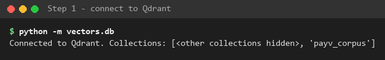
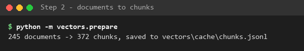
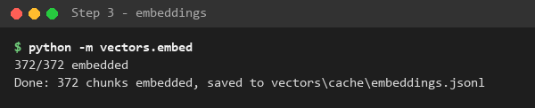
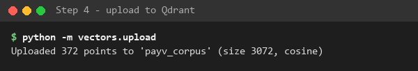
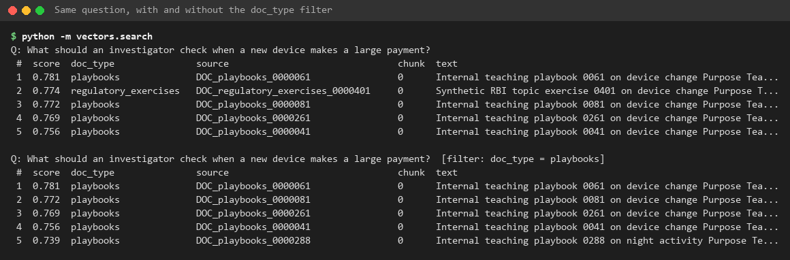
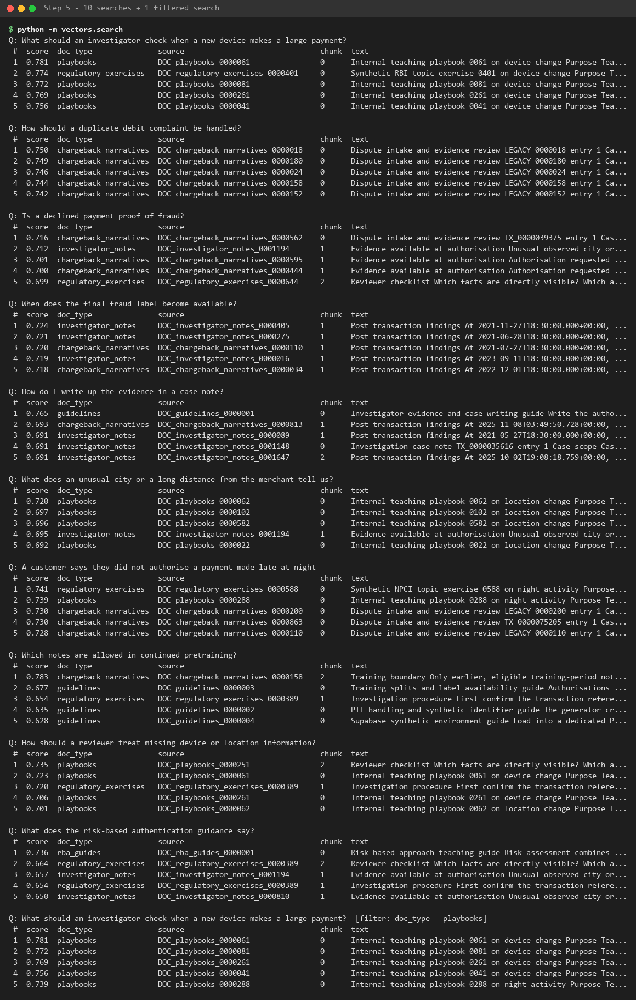

# Semantic search over the PayV corpus

This module makes the PayV document corpus **searchable by meaning**. The corpus holds RBI and NPCI guidelines, fraud playbooks, investigator notes and chargeback narratives.

An investigator can ask a question in plain English, such as *"what should I check when a new device makes a large payment?"*. The search returns the most relevant passages, even when they use different words: *"Device not observed for this customer in the preceding 90 days…"*.

This is also the **retrieval layer** for a later RAG (retrieval-augmented generation) setup: a model first finds the right passages here, then answers from them.

---

## How it works

```
Indexing (run once, or when the corpus changes)

  data/corpus ──► prepare.py ──► embed.py ──────────► upload.py ──► Qdrant Cloud
                  clean + chunk   Gemini Embedding 2   collection     payv_corpus
                  (372 chunks)    (3,072 numbers each) + payload      (372 points)

Searching (every question)

  question ──► Gemini Embedding 2 ──► Qdrant (Cosine similarity) ──► top 5 passages + scores
               (same model)           optional filter on doc_type
```

| Component | Choice |
|---|---|
| Vector database | **Qdrant Cloud** (free tier), collection `payv_corpus` |
| Embedding model | **Gemini Embedding 2** (`gemini-embedding-2-preview`), 3,072 dimensions, through the **EURI** gateway |
| Chunking | LangChain `RecursiveCharacterTextSplitter`, 800 characters with 150 overlap |
| Similarity | Cosine |

### Files

| File | Role |
|---|---|
| [db.py](db.py) | Qdrant connection (`get_client()`) and health check |
| [prepare.py](prepare.py) | Samples, cleans and chunks the documents, giving `cache/chunks.jsonl` |
| [embed.py](embed.py) | Embeds each chunk (`embed()`), giving `cache/embeddings.jsonl` |
| [upload.py](upload.py) | Creates the collection and uploads the points |
| [search.py](search.py) | Search by meaning, with an optional `doc_type` filter |
| [search_results.txt](search_results.txt) | Output of the reference queries (see [Search quality](#search-quality)) |
| [screenshots/](screenshots/) | Terminal output of each stage (see [Screenshots](#screenshots)) |

`cache/` is git-ignored. Its files can be rebuilt at any time with `prepare.py` and `embed.py`.

---

## Setup

### Prerequisites

- Python 3.11 or newer
- The corpus in `data/corpus/` (part of this repository)
- A **Qdrant Cloud** account (the free tier is enough)
- A **EURI** API key, used for Gemini Embedding 2

### 1. Create the Qdrant cluster

1. Sign in at [cloud.qdrant.io](https://cloud.qdrant.io) and choose **Create cluster**, then the **Free** tier and a nearby region.
2. Wait until the cluster status is **Healthy**.
3. Copy the **Cluster URL** (`https://<id>.<region>.cloud.qdrant.io`).
4. Under **API Keys**, create a key with read and write access. Copy it straight away, because it is shown only once.

### 2. Get the EURI API key

1. Sign in to the EURI dashboard and create an API key.
2. Check the exact model name for Gemini Embedding 2 in its model list. This project uses `gemini-embedding-2-preview`, set as `MODEL` in [embed.py](embed.py).

### 3. Create the environment and install the packages

From the project root:

```bash
python -m venv .venv
source .venv/Scripts/activate        # Git Bash on Windows
# .venv\Scripts\Activate.ps1          # PowerShell
# source .venv/bin/activate           # macOS / Linux

python -m pip install -r requirements.txt
```

This module uses these packages, all pinned in `requirements.txt`:

| Package | Used for |
|---|---|
| `qdrant-client` | Creating the collection, uploading and searching |
| `requests` | Calling the EURI embeddings endpoint |
| `langchain-text-splitters` | Chunking |
| `pandas` | Loading and sampling the corpus |
| `python-dotenv` | Reading `.env` |

**Windows Smart App Control:** if an install fails with *"An Application Control policy has blocked this file"*, pin an older version of the blocked package. For example, `langchain-text-splitters` pulls in `xxhash`, and only `xxhash==4.0.2` loads on such machines:

```bash
python -m pip install langchain-text-splitters "xxhash==4.0.2"
```

### 4. Add the secrets to `.env`

Add these lines to `.env` in the project root. The file is git-ignored and never committed.

```
QDRANT_URL=https://<your-cluster>.cloud.qdrant.io
QDRANT_API_KEY=<qdrant key>
EURI_API_KEY=<euri key>
```

---

## How to run

Run every command **from the project root**, as a module (`python -m vectors.<name>`), so the imports between the files work.

| Order | Command | What it does | Time |
|---|---|---|---|
| 1 | `python -m vectors.db` | Checks the Qdrant connection and lists the collections | seconds |
| 2 | `python -m vectors.prepare` | Samples, cleans and chunks the documents into `cache/chunks.jsonl` | seconds |
| 3 | `python -m vectors.embed` | Embeds every chunk into `cache/embeddings.jsonl` (resumable) | a few minutes |
| 4 | `python -m vectors.upload` | Rebuilds the `payv_corpus` collection and uploads the points | seconds |
| 5 | `python -m vectors.search` | Runs the 10 reference questions and the filtered query | ~30 s |

To keep the search output in a file:

```bash
python -m vectors.search > vectors/search_results.txt
```

**When to re-run what:**

| You changed… | Re-run |
|---|---|
| Sampling, cleaning or chunk settings in `prepare.py` | Steps 2–5. **Delete `vectors/cache/embeddings.jsonl` first**, otherwise `embed.py` thinks the work is already done. |
| The embedding model | Steps 3–5, after deleting `vectors/cache/embeddings.jsonl` |
| Only the questions in `search.py` | Step 5 only |

To test the embedding API on its own before a full run:

```bash
python -c "from vectors.embed import embed; v = embed('new device large payment'); print(len(v))"
# 3072
```

---

## Screenshots

Terminal output from building the index and searching it.

**1. Connection check.** Other collections in the shared cluster are hidden.



**2. Documents to chunks**



**3. Embeddings**



**4. Upload to Qdrant**



**5. The same question with and without the `doc_type` filter**



**6. All reference searches**



---

## 1. Connection

`get_client()` builds a `QdrantClient` from `QDRANT_URL` and `QDRANT_API_KEY`, with a 60-second timeout. Every other script reuses it. Running `db.py` on its own calls `get_collections()` as a health check.

The cluster is shared with other collections. This module only ever creates, replaces or reads `payv_corpus`.

---

## 2. Preparing the documents

### The corpus

Each document type lives in `data/corpus/<type>/<split>/`. A document row has `document_id`, `kind`, `title`, `content` and metadata. Most documents are about 1,900 characters long, written as short sections (Purpose, Context, Checks, …).

### Sampling

The index is built from the **train split**:
- at most **60 documents per type**, picked at random with a fixed seed, so it's the same sample every run;
- the small types in full.

That keeps every type fairly represented, so no single type dominates the results.

| Type (`kind`) | Documents | Chunks |
|---|---|---|
| chargeback_narratives | 60 | 122 |
| investigator_notes | 60 | 121 |
| regulatory_exercises | 60 | 63 |
| playbooks | 60 | 61 |
| guidelines | 4 (all) | 4 |
| rba_guides | 1 (all) | 1 |
| **Total** | **245** | **372** |

To index more of the corpus, raise `DOCS_PER_TYPE` in `prepare.py`.

### Cleaning

| What | Why |
|---|---|
| Remove the 169-character disclaimer that opens **every** document ("SYNTHETIC TRAINING MATERIAL. … production model output.") | The same text in every first chunk would make unrelated chunks look alike and add noise to every score. |
| Remove markdown heading marks (`## Purpose` becomes `Purpose`) | The symbols carry no meaning. |
| Collapse repeated spaces and blank lines | They waste room inside the chunk size. |

### Chunking: 800 characters, 150 overlap

| Setting | Value | Reasoning |
|---|---|---|
| Chunk size | **800 characters** (≈ 200 tokens, at ~4 characters per token) | A document is ~1,900 characters of short sections. 800 characters holds one or two sections, which is **one idea per chunk**, so each vector has a clear meaning. Whole documents would mix topics and blur the vector; single sentences would lose their context. Most documents become ~3 chunks. |
| Overlap | **150 characters** (~1 sentence, ~20%) | The end of each chunk is repeated at the start of the next, so an idea that falls on a boundary is still found whole. |
| Split points | Line breaks, then sentence ends (`". "`), then spaces | Chunks end at section or sentence boundaries, never mid-word. |

Chunks are 220–800 characters long (median 641), well within Gemini Embedding 2's 8,192-token input limit.

### De-duplication

The documents are generated from templates, so some sections are **identical word for word** across many documents:

| Copies | Section |
|---|---|
| 120 | "Training boundary: Only earlier, eligible training-period notes …" |
| 120 | "Investigation procedure: First confirm the transaction reference …" |
| 120 | "Reviewer checklist: Which facts are directly visible? …" |

`prepare.py` keeps only the first copy of each chunk text, which takes 743 chunks down to **372**. Without this, a query could return the same passage five times, and the same text would be embedded up to 120 times.

### Output

`cache/chunks.jsonl` holds one chunk per line:

```json
{"source": "DOC_chargeback_narratives_0000158", "title": "Dispute intake and evidence review LEGACY_0000158 entry 1",
 "doc_type": "chargeback_narratives", "chunk": 0, "text": "Dispute intake and evidence review ... R05_AMOUNT_SPIKE, R01_NEW_DEVICE ..."}
```

- `chunk` is the chunk's position inside its document (0 = first part).
- `text` is the passage itself.

---

## 3. Embeddings

`embed()` sends one text to the EURI embeddings endpoint and returns its **3,072-number** vector. Search reuses the same function, so questions and passages are always embedded by the same model and can be compared.

- **One text per request.** Gemini Embedding 2 can merge a list of inputs into a single vector, so each chunk is sent on its own.
- **Rate limits.** An HTTP 429 is retried up to 5 times, waiting 1, 2, 4, 8 and 16 s (exponential backoff). Any other error stops the run.
- **Resumable.** The number of lines already in `embeddings.jsonl` is the restart point, so an interrupted run continues without paying twice. **If the chunks change, delete `cache/embeddings.jsonl` first.**
- **Size check.** The run stops if a vector doesn't have exactly 3,072 numbers, for example because the model name is wrong.

Each line of `cache/embeddings.jsonl` is the chunk plus `id` (0–371) and `vector`.

**Checks on the current build:**
- 372 vectors, IDs 0–371 with no gaps;
- every vector has 3,072 numbers;
- every vector has a norm of 1.0 (already normalised);
- no two vectors are identical.

---

## 4. The Qdrant collection

| Setting | Value | Reasoning |
|---|---|---|
| Collection | `payv_corpus` | Replaced on every `upload.py` run, so the index always matches the cache. Other collections are left alone. |
| Vector size | **3,072** | Must match the embedding model exactly. |
| Distance | **Cosine** | Compares the *direction* of two vectors (their meaning), not their size. It's the standard for text embeddings, and our vectors are normalised. Scores closer to 1 mean more similar. |
| Payload index | `doc_type` (KEYWORD, exact match) | Makes filtered searches fast. Qdrant Cloud may also refuse filters on fields without an index. |
| Upload | Batches of 64, `wait=True` | Each point is ~70 KB, so 64 per request (~4.5 MB) is a safe size. `wait=True` makes the final count reliable. |

Each point is an **id**, a **vector** and a **payload**:

```
id:      0
vector:  [0.0133, 0.0102, 0.005, ... 3,072 numbers]
payload: {
  "source":   "DOC_chargeback_narratives_0000158",    source document
  "title":    "Dispute intake and evidence review LEGACY_0000158 entry 1",
  "doc_type": "chargeback_narratives",                document type (indexed, filterable)
  "chunk":    0,                                      chunk number inside the document
  "text":     "Dispute intake and evidence review ..."  shown with search results
}
```

The payload isn't embedded, so it doesn't affect the score. Qdrant returns it with each result, to show *what* matched and *where it came from*, and it can be used to filter.

---

## 5. Searching

`search(question, doc_type=None)` embeds the question, calls `query_points` and prints the top 5 passages with their score, type, source and chunk number. Passing `doc_type` restricts the search to one document type:

```python
search("What should an investigator check when a new device makes a large payment?")
search("What should an investigator check when a new device makes a large payment?", doc_type="playbooks")
```

The filter is a Qdrant payload condition:

```python
Filter(must=[FieldCondition(key="doc_type", match=MatchValue(value="playbooks"))])
```

### Search quality

`search.py` runs 10 reference questions plus one filtered query. The full output is in [search_results.txt](search_results.txt).

| # | Question | Top result | Score | Assessment |
|---|---|---|---|---|
| 1 | What should an investigator check when a new device makes a large payment? | Playbooks "on device change" | 0.781 | Relevant |
| 2 | How should a duplicate debit complaint be handled? | Chargeback dispute reviews (all 5) | 0.750 | Relevant |
| 3 | Is a declined payment proof of fraud? | Chargeback / evidence passages | 0.716 | Misses the key guideline |
| 4 | When does the final fraud label become available? | "Post transaction findings" passages | 0.724 | Partly relevant |
| 5 | How do I write up the evidence in a case note? | **Investigator evidence and case writing guide** | 0.765 | Relevant, clear margin |
| 6 | What does an unusual city or a long distance from the merchant tell us? | Playbooks "on location change" | 0.720 | Relevant |
| 7 | A customer says they did not authorise a payment made late at night | Exercise and playbook "on night activity" | 0.741 | Relevant |
| 8 | Which notes are allowed in continued pretraining? | **"Training boundary" passage** | 0.783 | Relevant, clear margin |
| 9 | How should a reviewer treat missing device or location information? | "Reviewer checklist" and device playbooks | 0.735 | Relevant |
| 10 | What does the risk-based authentication guidance say? | **Risk based approach teaching guide** | 0.736 | Relevant, clear margin |

Example (question 1):

```
Q: What should an investigator check when a new device makes a large payment?
 #  score  doc_type               source                               chunk  text
 1  0.781  playbooks              DOC_playbooks_0000061                0      Internal teaching playbook 0061 on device change Purpose Tea...
 2  0.774  regulatory_exercises   DOC_regulatory_exercises_0000401     0      Synthetic RBI topic exercise 0401 on device change Purpose T...
 3  0.772  playbooks              DOC_playbooks_0000081                0      Internal teaching playbook 0081 on device change Purpose Tea...
 4  0.769  playbooks              DOC_playbooks_0000261                0      Internal teaching playbook 0261 on device change Purpose Tea...
 5  0.756  playbooks              DOC_playbooks_0000041                0      Internal teaching playbook 0041 on device change Purpose Tea...
```

The same question, filtered to `doc_type = playbooks`:

```
Q: What should an investigator check when a new device makes a large payment?  [filter: doc_type = playbooks]
 #  score  doc_type               source                               chunk  text
 1  0.781  playbooks              DOC_playbooks_0000061                0      Internal teaching playbook 0061 on device change Purpose Tea...
 2  0.772  playbooks              DOC_playbooks_0000081                0      Internal teaching playbook 0081 on device change Purpose Tea...
 3  0.769  playbooks              DOC_playbooks_0000261                0      Internal teaching playbook 0261 on device change Purpose Tea...
 4  0.756  playbooks              DOC_playbooks_0000041                0      Internal teaching playbook 0041 on device change Purpose Tea...
 5  0.739  playbooks              DOC_playbooks_0000288                0      Internal teaching playbook 0288 on night activity Purpose Te...
```

The regulatory exercise at #2 drops out, and the next-best playbook moves in at #5.

**Observations:**
- **8 of 10** questions return clearly relevant passages first. When a single document answers the question (the case-writing guide, the training boundary, the RBA guide), it wins by a clear margin.
- **Questions 3 and 4 miss the best answer.** The guideline that says "A decline is not a fraud label … The verdict is known sixty days after the transaction" isn't in their top 5, because many template passages with similar wording crowd it out.
- **Scores sit close together** (about 0.63–0.78), because the documents share a template structure. The *ranking* is more informative than the absolute score.

---

## Known limitations and next steps

- **Template-heavy corpus.** Similar passages compete for the same queries. Possible fixes:
  - prepend the document title to each chunk before embedding;
  - add **hybrid search** (keyword + meaning) for exact terms such as "decline" or "label";
  - **re-rank** the top 20 results before showing the top 5.
- **Sample, not the full corpus.** The index covers 245 train documents. Raising `DOCS_PER_TYPE` indexes more; the free cluster has room, since each vector is ~12 KB.
- **Validation and holdout splits** aren't indexed yet. They can be added as a payload field (`split`) and filtered on.
- **RAG.** The next step is to pass the top passages from `search()` to an LLM, so it answers investigator questions with citations to `source` and `chunk`.
